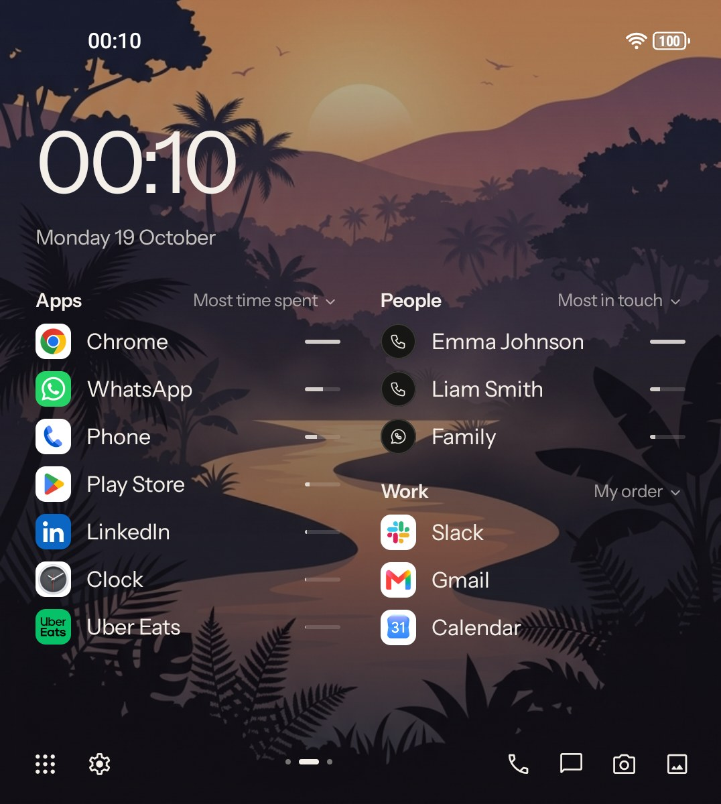
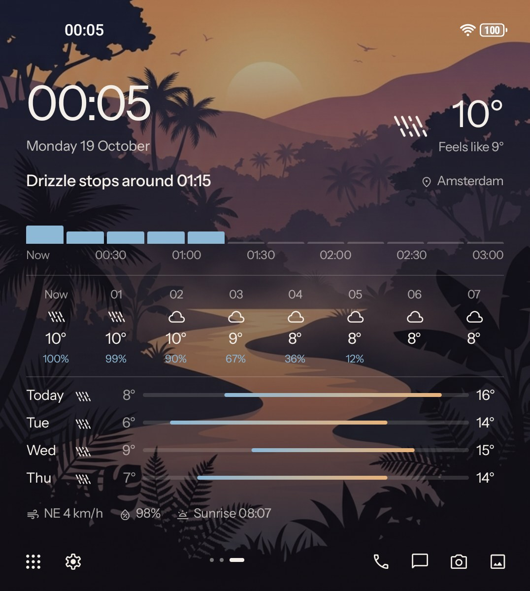
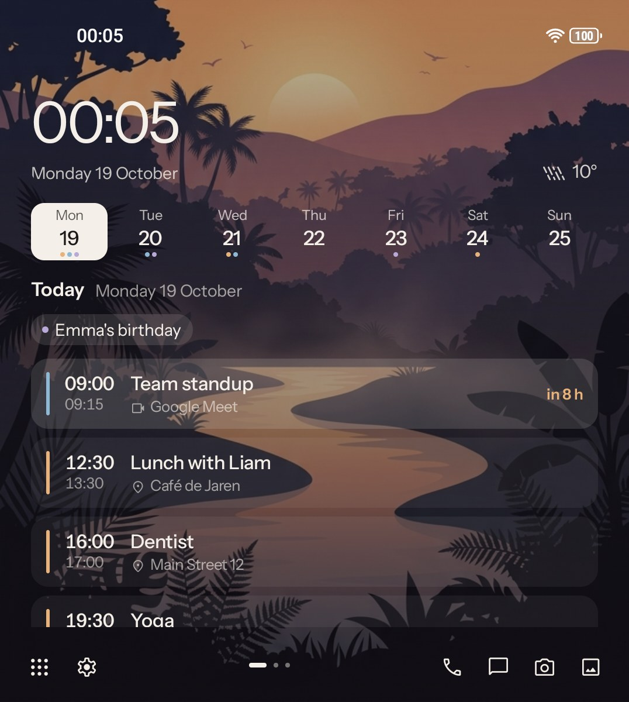
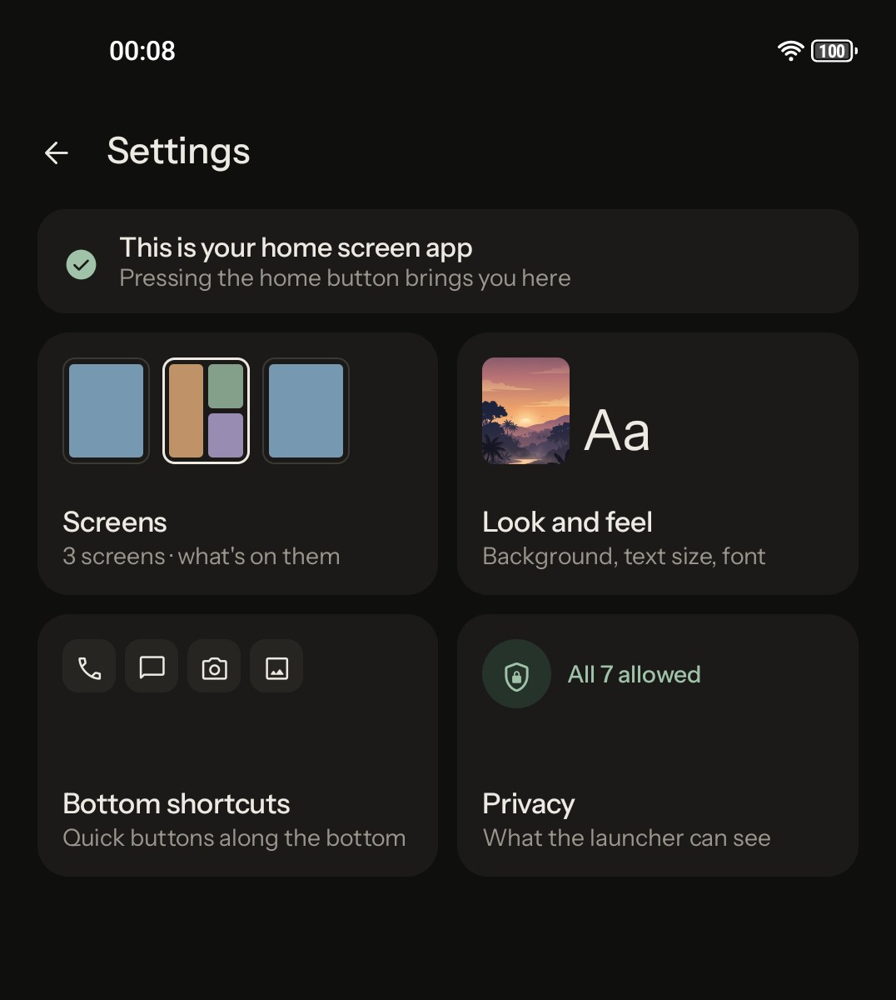
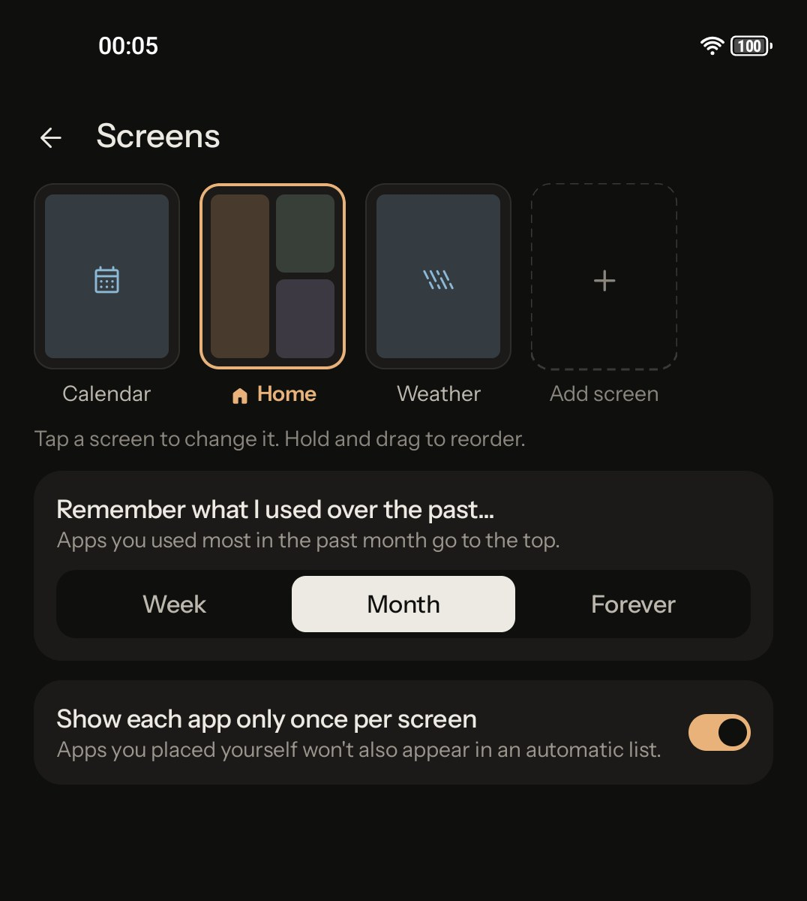
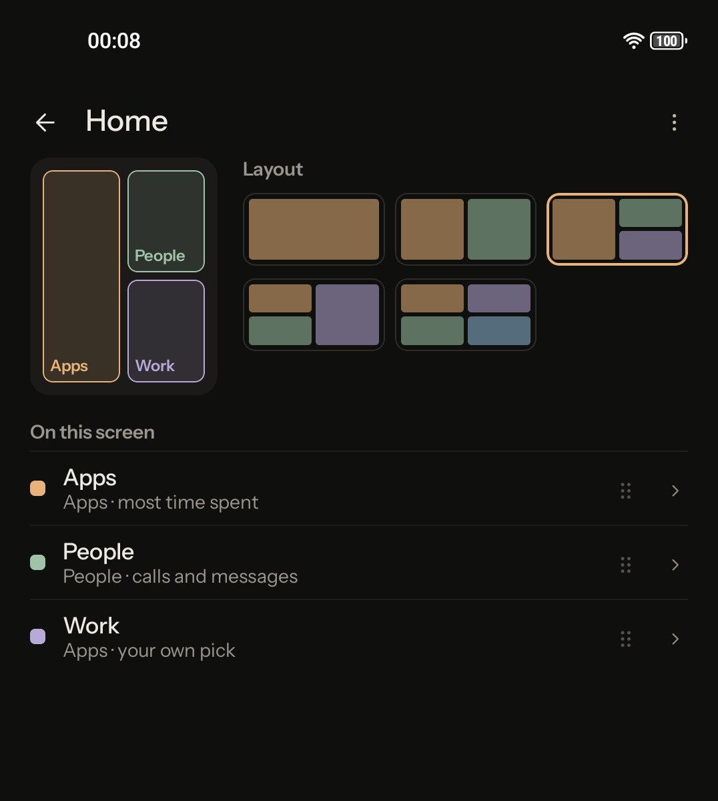
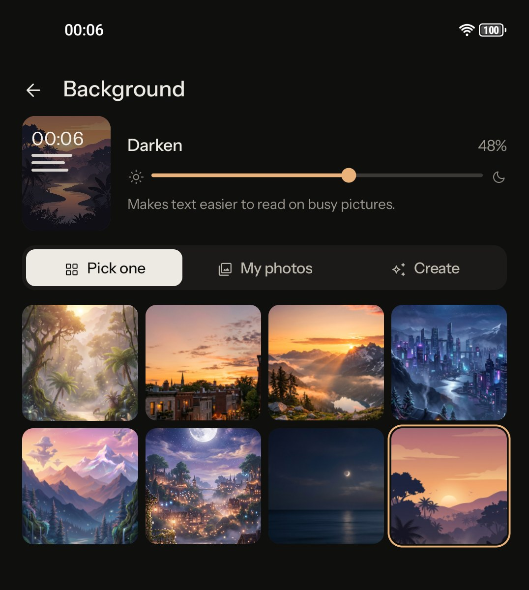
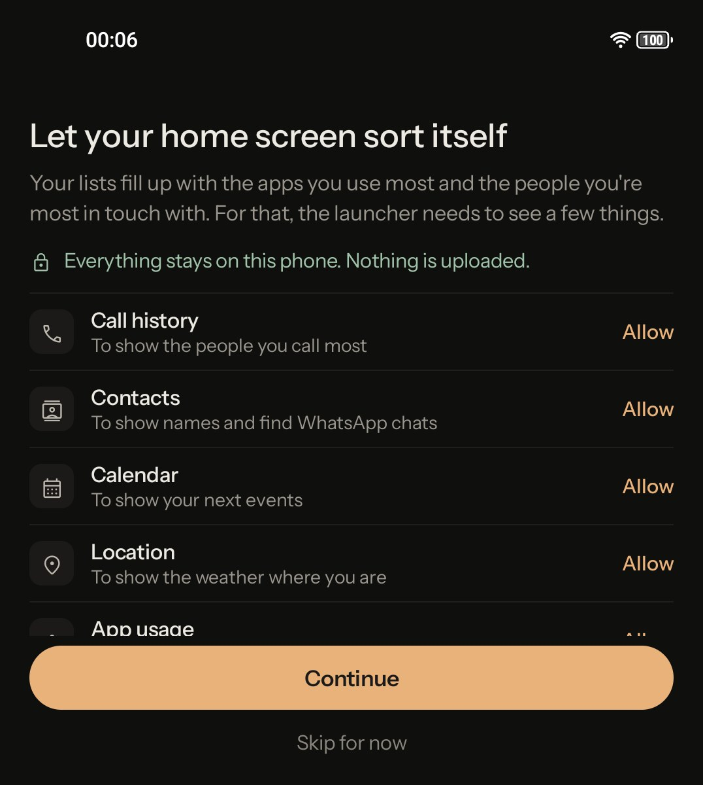

# Auto Minimal Launcher

A minimal Android launcher whose lists fill themselves with the apps you use most and the people you're most in touch with. Built with Kotlin and Jetpack Compose from the "Auto Minimal Launcher" design file.

It's made for phones with a physical keyboard, such as the Unihertz Titan 2 Elite, the Clicks Communicator and the Minimal Phone 2.

| Home | Weather | Calendar |
| --- | --- | --- |
|  |  |  |
| **Settings** | **Screens settings** | **Home screen layout** |
|  |  |  |
| **Background settings** | **First-run setup** | |
|  |  | |

## Using it

- **Home**: a large clock (tap it to open alarms) and the date, then up to four blocks of apps, people, your calendar or the weather. Each list row has a small bar showing how much you use it compared to the top item.
- **Sorting a list**: tap the label next to a block's title ("Most time spent") to pick how it's sorted: time spent, times opened or your own pick for apps, and most called, most messaged or most in touch for people.
- **Holding a row**: an app shows how much you used it, with App info, Don't show on home, and Uninstall. A person gets big Call and chat buttons.
- **Screens**: swipe left and right between screens. The dots in the bottom bar show where you are.
- **All apps**: swipe up on home or tap the grid icon. Your five most used apps are on top, then an A–Z list with a letter index. Search shows Play Store and web search when nothing matches. Pull down to close it.
- **Settings**: long-press the grid icon or an empty part of home. There are four sections:
  - **Screens**: add, reorder (hold and drag) and edit screens, and choose the period lists look at.
  - **Look and feel**: text size, font and background.
  - **Bottom shortcuts**: turn shortcuts on or off and choose the app each one opens.
  - **Privacy**: every permission and what it gives you.
- Swipe down on home to open the notification shade.

## Permissions

All permissions are optional. A block that needs a missing permission says so and offers to allow it. Settings › Privacy lists them all.

| Permission | Used for |
| --- | --- |
| App usage | Ranking apps by time spent and times opened |
| Call history | The people you call most |
| Contacts | Names, and finding WhatsApp chats for a contact |
| Message counts (notification access) | Counting WhatsApp, Signal, Telegram and text messages per chat. Only the chat name and a timestamp are stored, never message text. |
| Calendar | Your next events |
| Location | The weather where you are |
| Default launcher | Opening when you press home |

## Generated backgrounds

Settings › Look and feel › Background › Create builds an image from three words: a mood, a place and a time of day.

- **Pollinations** (default) is free and needs no account. Anonymous use is limited to one image every 45 seconds per IP.
- **Gemini**: tap "Use Gemini" on the Create page and paste an API key from [aistudio.google.com](https://aistudio.google.com). The default model is `gemini-2.5-flash-image`.

The launcher keeps the last nine generated images. They appear after the built-in pictures under Pick one.

## Build

```sh
./gradlew assembleDebug        # app/build/outputs/apk/debug/app-debug.apk
./gradlew testDebugUnitTest
adb install -r app/build/outputs/apk/debug/app-debug.apk
```

Then press Home and pick Auto Minimal Launcher, or tap the first card in Settings.

### Screenshots

Debug builds have a demo mode with placeholder people, events and a short list of common apps:

```sh
adb shell run-as com.autominimal.launcher touch files/demo                       # demo data
adb shell "run-as com.autominimal.launcher sh -c 'echo setup > files/demo'"      # also show the setup screen
adb shell run-as com.autominimal.launcher rm files/demo                          # back to normal
adb shell am force-stop com.autominimal.launcher                                 # after each change
```

Fonts: Instrument Sans, IBM Plex Sans, IBM Plex Mono, Newsreader, Roboto Condensed and JetBrains Mono under the SIL Open Font License (`FONTS-OFL.txt`). Icons: Material Symbols, Apache License 2.0.
